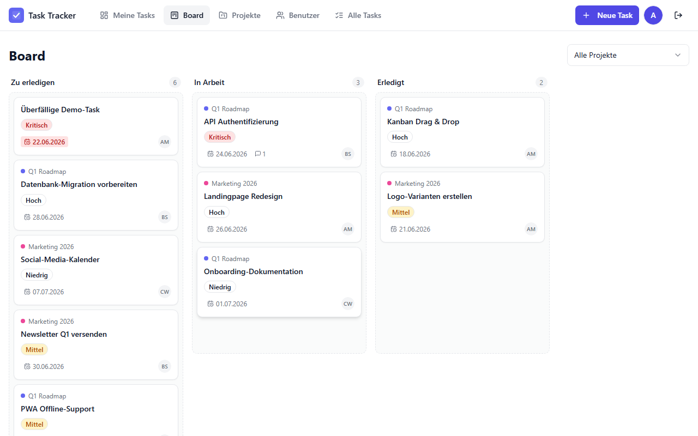

# Task Tracker · متعقب المهام

A lightweight, MS-Planner-style task tracker with **Admin / User roles**, a
**Kanban board with drag & drop**, projects, comments, file attachments, search,
web-push notifications and **PWA** install support.

**Arabic-first (RTL)** — the default language is Arabic with a full right-to-left
layout; **English** and **German** are also available via the in-app language
switcher (Globe icon). The UI uses **logical CSS properties** (`ms/me/ps/pe/start/end`)
so direction flips cleanly, with **Cairo** for Arabic and **Inter** for Latin scripts.

Light, airy **"cool" theme** only (no dark mode): Sky-Blue primary, Teal accent,
off-white background — a Linear/Notion-like feel.

Built with **Next.js 14 (App Router)**, **TypeScript**, **Prisma + SQLite**,
**Tailwind + shadcn/ui**, cookie-session auth with **argon2**, and `@dnd-kit`.



---

## Quick start

```bash
# 1. install deps
npm install

# 2. set up env (defaults already work for local dev)
cp .env.example .env        # on Windows: copy .env.example .env

# 3. create the database + seed demo data
npx prisma migrate dev      # creates dev.db, runs migration + seed

# 4. run
npm run dev
```

Open **http://localhost:3000** → you land on the login page.

> If port 3000 is busy: `npm run dev -- -p 3100`.

### Demo credentials

| Role  | Username                  | Password     |
| ----- | ------------------------- | ------------ |
| Admin | `admin`                   | `Admin-2026!` |
| User  | `alice` / `bob` / `charlie` | `Demo-2026!`  |

The admin sees **all** tasks and the user-management screens. Regular users only
see tasks they created or that are assigned to them.

---

## Features

- 🔐 **Cookie-session auth** (httpOnly, argon2 password hashing), 2 roles with **server-side permission checks** — regular users see only their own tasks, can't reach `/admin/*` or reassign tasks; admins see everything
- 🔗 **Task links / dependencies** — Depends-on / Blocks / Related-to / Subtask-of, with a "⚠️ waiting on N" card badge that clears automatically when blockers complete
- 🔔 **Toasts** for action feedback, **skeleton loaders** on navigation
- 🧭 **Welcome tour** (react-joyride) on first login — role-aware (8-step admin / 5-step user), RTL-ready, skippable, restartable from Settings; `User.hasSeenTour` gates it
- 📋 **Task CRUD** — title, description, status, priority, assignee, due date, project
- 🗂️ **Kanban board** with drag & drop (`@dnd-kit`) — status updates on drop, optimistic UI
- 📊 **Progress** per task (0–100) — manual slider + quick buttons, or **auto-derived from subtasks**
- ☑️ **Subtasks / checklist** per task — toggle items, progress recalculates automatically
- ⏱️ **Time tracking** — estimated vs. spent hours, **start/stop timer**, "X of Y", days-remaining, pulsing overdue badge, "done N ago"
- 📁 **Projects** — colour-coded, per-project board (`/projects/{id}/board`)
- 👤 **Assign to user** + **web-push notification** on assignment (optional, see below)
- ⏰ **Due dates** with overdue / due-today highlighting
- 💬 **Comments** per task
- 📎 **File upload** (images + PDF, max 5 MB) stored under `public/uploads`
- 📥 **MS Planner / Excel import** (`/admin/import`) — upload the Planner `.xlsx`, preview (task/user/bucket counts + status & priority breakdown), then import; buckets map to statuses, users auto-created, **idempotent** (re-import updates instead of duplicating)
- 🔎 **Comprehensive filters** — reusable URL-synced FilterBar (project, team, multi-assignee, status group, priority, date range, search) on `/admin/tasks`, `/board`, user / team / project pages; combinable (ANDed), removable chips, result counter "X of Y", mobile filter modal
- 🌍 **i18n** Arabic (default, RTL) / English / German — switch via the Globe icon or Settings
- 📱 **PWA** — installable manifest, service worker, offline shell, mobile-responsive
- 👆 **Mobile board** — horizontal swipe between columns (scroll-snap) with quick-jump dots; long-press (450 ms) to drag a card, short swipe to scroll
- 🛡️ **Admin** screens: user management + global task list
- 👤 **User detail + performance** — per-user tasks (grouped, filterable) and a metrics dashboard (completed 7/30/90/total, on-time rate, avg completion, overdue, 30-day productivity chart, top projects)
- 👥 **Teams** — Team entity with member management and per-team stats (total / done / active / overdue); tasks can belong to a team and a project
- 🧭 **Sidebar navigation** (desktop) with active indicator + StatCards and inline-SVG charts

---

## Scripts

| Command              | Description                                  |
| -------------------- | -------------------------------------------- |
| `npm run dev`        | Dev server (PWA disabled for fast reloads)   |
| `npm run build`      | Production build (`prisma generate` + build) |
| `npm start`          | Run the production build                      |
| `npm run seed`       | Re-seed demo data                            |
| `npm run db:reset`   | Drop, re-migrate and re-seed the database    |
| `npm test`           | Unit tests (Vitest) — logic + validation     |
| `npm run test:e2e`   | Playwright happy-path tests                   |

### Tests

```bash
npm test                 # 17 unit tests (task logic, zod schemas)

# e2e (needs a build + the chromium browser once):
npm run build
npx playwright install chromium
npm run test:e2e
```

---

## Web Push (optional)

Push is **off by default** and the app works fully without it. To enable:

```bash
npx web-push generate-vapid-keys
```

Put the keys in `.env`:

```ini
NEXT_PUBLIC_VAPID_PUBLIC_KEY="BL...."
VAPID_PRIVATE_KEY="...."
VAPID_SUBJECT="mailto:you@example.com"
```

Restart, open **Settings → Notifications → Enable push**. When a task is assigned
to a user, they receive a browser notification (handled by `worker/index.js`).

---

## Tech & data model

```
User ─< Task >─ Project
        │  ├─< TaskComment
        │  └─< TaskAttachment
        └─< Session (cookie auth)
User ─< PushSubscription
```

Enums (role / status / priority / locale) are stored as strings because SQLite
has no native enum; allowed values are validated in `src/lib/enums.ts` and the
zod schemas in `src/lib/validation.ts`.

### Project structure

```
prisma/            schema, migration, seed
src/
  actions/         server actions (auth, tasks, projects, users, settings)
  app/
    login/         public login page
    (app)/         authenticated area (dashboard, board, projects, tasks, admin, settings)
    api/push/      push subscription endpoint
  components/      UI primitives (ui/) + feature components
  lib/             prisma, auth, i18n, validation, task logic, push
worker/            custom service-worker (push handlers)
scripts/           icon generator, screenshot helper
e2e/               Playwright tests
```

See **[DEPLOY.md](DEPLOY.md)** for deployment (Vercel / VPS / Cloudflare).
