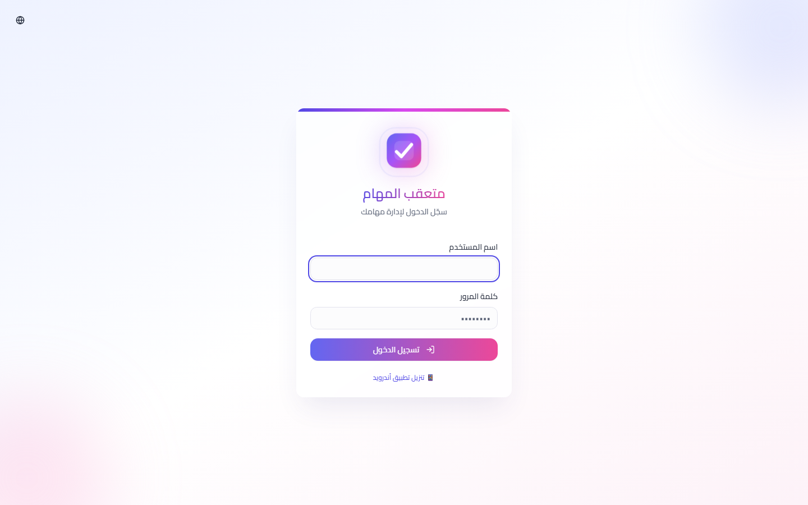
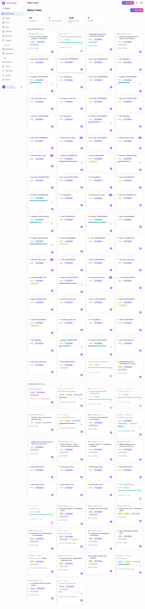
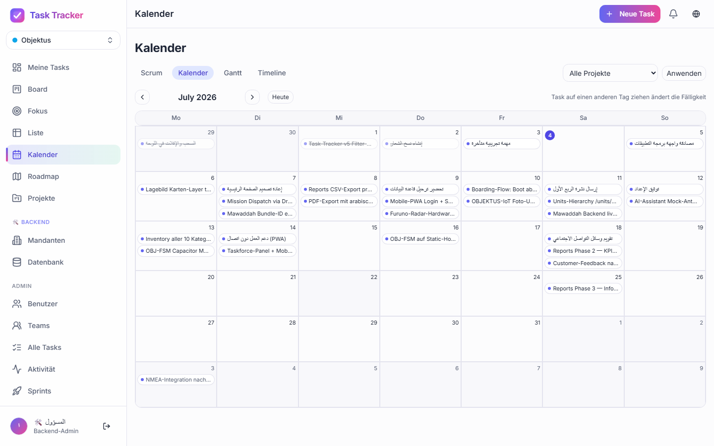
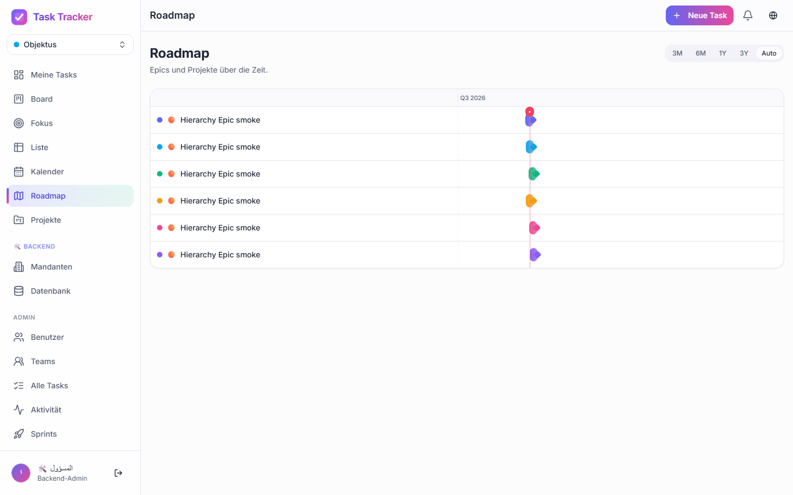
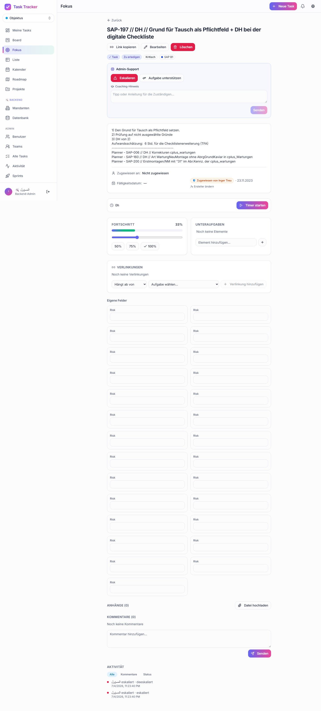
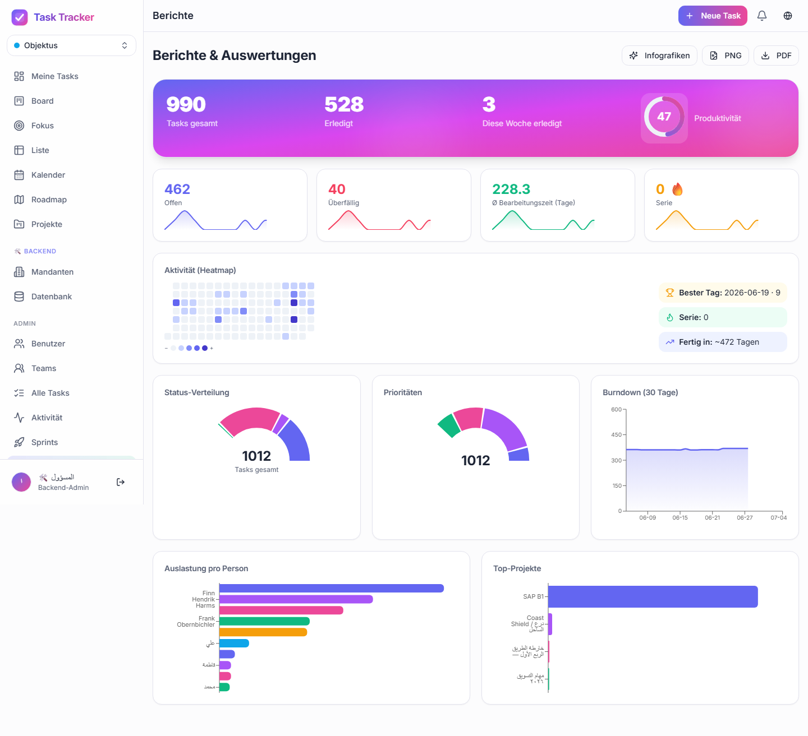
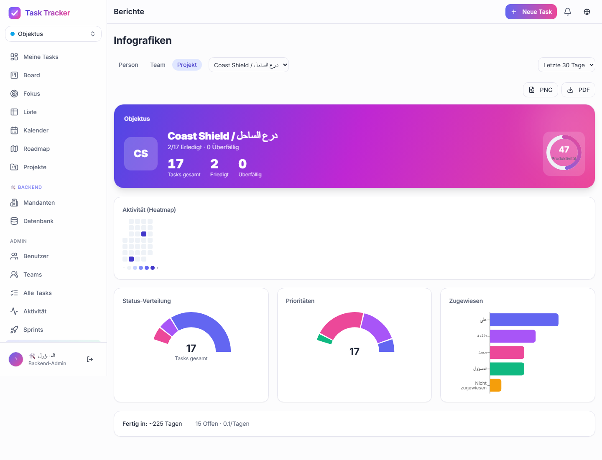

# Task Tracker · متعقب المهام

> 🏢 **Multi-tenant**: data is isolated per tenant (e.g. `objektus`, `tarek`, `marine`). Every user belongs to a tenant and only sees that tenant's data; a **BackendAdmin** (super-admin) can switch tenants (sidebar switcher or `/t/{slug}`). Isolation is enforced server-side on every query — never trusted from the client. See [docs/MULTI-TENANT-SECURITY.md](docs/MULTI-TENANT-SECURITY.md).

**v3.0.0** — a full-featured, MS-Planner-style task tracker: Kanban / List / Scrum / Calendar / Gantt / Roadmap views, projects, sprints, task hierarchy (Epic → Story → Task → Subtask, plus Bug), multi-assignee tasks, comments with read-receipts, file attachments, time tracking, custom fields, automation rules, reporting & infographics, SSO, MS Planner two-way sync, web-push + email + native notifications, per-tenant white-label branding, and a native Android (Capacitor) shell — all on top of a **PWA**.

**Arabic-first (RTL)** — the default language is Arabic with a full right-to-left
layout; **English** and **German** are also available via the in-app language
switcher (Globe icon) or **Settings**. The UI uses **logical CSS properties**
(`ms/me/ps/pe/start/end`) so direction flips cleanly, with **Cairo** for Arabic
and **Inter** for Latin scripts.

**Dark / Light / System** theme toggle (no-flash, persisted per browser).

Built with **Next.js 14 (App Router)**, **TypeScript**, **Prisma + PostgreSQL**,
**Tailwind + shadcn/ui**, cookie-session auth with **argon2**, `@dnd-kit`, and
**Capacitor** for the Android shell.


---

## Quick start

```bash
# 1. install deps
npm install

# 2. set up env (defaults already work for local dev)
cp .env.example .env        # on Windows: copy .env.example .env

# 3. create the database + seed demo data
npx prisma migrate dev      # runs migrations + seed (needs a running Postgres, see below)

# 4. run
npm run dev
```

Open **http://localhost:3000** → you land on the login page.

> Local dev needs a Postgres connection string in `DATABASE_URL` (`.env.example`
> ships a default for a local/dockerized Postgres). If port 3000 is busy:
> `npm run dev -- -p 3100`.

### Demo credentials

| Role         | Username                     | Password      |
| ------------ | ----------------------------- | ------------- |
| BackendAdmin | `superadmin`                  | `Super-2026!` |
| Admin        | `admin`                       | `Admin-2026!` |
| User         | `alice` / `bob` / `charlie`   | `Demo-2026!`  |

BackendAdmin spans every tenant and can switch between them; Admin manages one
tenant (users, teams, projects, workflow, reports); regular Users only see
tasks in projects they're a member of, or tasks assigned to them.

---

## Features

### Core task management
- 🔐 **Cookie-session auth** (httpOnly, argon2 password hashing), 3-tier roles (**BackendAdmin / Admin / User**) with server-side permission checks on every route and server action
- 🗂️ **Multiple views** — Kanban board (`@dnd-kit`, drag & drop), sortable **List** with multi-select bulk actions, **Scrum board**, **Calendar / Gantt / Timeline** (`/views`), and an auto-zooming **Roadmap** (3M/6M/1Y/3Y presets)
- 🧬 **Task hierarchy** — Epic → Story → Task → Subtask, with Bug as an orthogonal type; parent/child rollups and roadmap lanes
- 👥 **Multi-assignee tasks** — one primary assignee ("Hauptkopf") plus co-assignees, all visible on cards, filters and reports
- 🔗 **Task links / dependencies** — Depends-on / Blocks / Related-to / Subtask-of, with a "waiting on N" badge that clears automatically when blockers complete
- 📊 **Progress** per task (0–100) — manual slider or **auto-derived from subtasks**
- ⏱️ **Time tracking** — estimated vs. spent hours, optimistic start/stop timer, overdue badges
- 🔁 **Recurring tasks** — iCal-style RRULE, a cron spawns the next instance automatically
- 🧩 **Custom fields** (text/number/select/date/checkbox) and **automation rules** (when status/priority changes → set another field), configured per tenant/project in Admin
- 📋 **Task templates** with categories, for one-click task creation

### Collaboration
- 💬 **Comments** with **Telegram-style read receipts** (✓ sent / ✓✓ read by all watchers)
- 📎 **File attachments** (images, PDF, Office docs, zip — up to 10 MB), stored under `public/uploads`
- 📜 **Activity feed** per task and a tenant-wide **admin activity log** with field-level change tracking
- 🧭 **Focus views** (admin) — All / Person / Team / Project tabs, plus per-user **saved views**
- 🔎 **Comprehensive filters** — reusable URL-synced FilterBar (project, team, multi-assignee, status, priority, date range, search), combinable and shareable via URL

### Projects, teams & sprints
- 📁 **Projects** — colour-coded, admin-only creation, project-scoped board, custom **workflow columns** with WIP limits, project membership grants full project visibility to members
- 👥 **Teams** — member management, per-team stats (total / done / active / overdue)
- 🏁 **Sprints / Cycles** — sprint board per project with story points and active-sprint header

### Reporting & insights
- 📊 **Reports dashboard** — burndown, workload, heatmap, status/priority distribution
- 🖼️ **Infographics** — drill-down report cards by User / Team / Project with a productivity score and narrative "AI insights" (deterministic streak/trend/forecast text, no external LLM call)
- 📈 **Predictive Insights** — velocity forecast, burnout-risk and bottleneck detection, effort-vs-reality analysis

### Notifications
- 🔔 **In-app bell** (near-real-time, ~30s poll + instant refresh on focus), **web-push**, **email** (via Resend) and **native push** (Android via FCM through Capacitor)
- ⚙️ Per-user preferences per event type (assigned, status change, comment, mention, due-soon, overdue, blocker-resolved, recurring), quiet hours, and a daily-digest mode

### Integrations
- 🔄 **MS Planner two-way sync** via Microsoft Graph — pull / push / two-way per project, delta-token incremental sync ([docs/PLANNER-SYNC.md](docs/PLANNER-SYNC.md))
- 🔑 **SSO** — Microsoft (Azure AD), Google, GitHub, Apple, enabled per tenant with email-domain routing and auto-provisioning ([docs/SSO-SETUP.md](docs/SSO-SETUP.md))
- 📥 **MS Planner / Excel import** (`/admin/import`) — idempotent re-import (updates instead of duplicating)

### Admin & platform
- 🏢 **Multi-tenant** isolation enforced server-side on every query, with a BackendAdmin tenant-onboarding wizard and DB console
- 🎨 **Per-tenant white-label branding** (logo, colours, theme)
- 🌗 **Dark / Light / System** theme, no dark-mode-only lock-in
- 🌍 **i18n** Arabic (default, RTL) / English / German
- 📱 **PWA** — installable manifest, service worker, offline shell, in-app "update available" prompt
- 🤖 **Native Android app** (Capacitor, `net.coastshield.tasktracker`) with camera attachment capture, native push and an in-app APK download link ([docs/MOBILE-APK.md](docs/MOBILE-APK.md))
- 🧭 **Welcome tour** (role-aware, RTL-ready, restartable from Settings)

---

## Screenshots

| | |
|---|---|
|  Login |  Dashboard |
|  Kanban board |  List view |
|  Calendar / Gantt |  Scrum board |
|  Roadmap |  Task detail |
|  Reports |  Infographics |

More screens (admin, settings, mobile, Arabic RTL) live under
[`screenshots/v3/`](screenshots/v3) and [`screenshots/v3-ar/`](screenshots/v3-ar).

---

## Scripts

| Command                  | Description                                       |
| ------------------------- | -------------------------------------------------- |
| `npm run dev`             | Dev server (PWA disabled for fast reloads)          |
| `npm run build`           | Production build (`prisma generate` + `next build`) |
| `npm start`               | Run the production build                           |
| `npm run seed`            | Re-seed demo data                                  |
| `npm run bootstrap`       | First-time DB bootstrap (migrate + seed)           |
| `npm run db:reset`        | Drop, re-migrate and re-seed the database          |
| `npm test`                | Unit tests (Vitest) — logic + validation           |
| `npm run test:e2e`        | Playwright happy-path tests                        |
| `npm run audit:tenant`    | Static scan for unscoped (non-tenant-filtered) Prisma queries |
| `npm run cap:sync`        | Sync web build into the Capacitor Android project  |
| `npm run apk:debug`       | Build a debug APK locally (needs Android SDK + JDK 17) |

### Tests

```bash
npm test                 # unit tests (task logic, zod schemas, notification routing, tenant scoping)

# e2e (needs a build + the chromium browser once):
npm run build
npx playwright install chromium
npm run test:e2e
```

---

## Web Push (optional)

Push is **off by default** and the app works fully without it. To enable:

```bash
npx web-push generate-vapid-keys
```

Put the keys in `.env`:

```ini
NEXT_PUBLIC_VAPID_PUBLIC_KEY="BL...."
VAPID_PRIVATE_KEY="...."
VAPID_SUBJECT="mailto:you@example.com"
```

Restart, open **Settings → Notifications → Enable push**. See
[docs/NOTIFICATIONS.md](docs/NOTIFICATIONS.md) for the full notification-channel
matrix (in-app / web-push / email / native) and required env vars.

---

## Tech & data model

Multi-tenant core: every tenant-scoped model (`User`, `Task`, `Project`, `Team`,
`Sprint`, `Notification`, …) carries a `tenantId`, enforced server-side on every
query — see [docs/ARCHITECTURE.md](docs/ARCHITECTURE.md) and
[docs/MULTI-TENANT-SECURITY.md](docs/MULTI-TENANT-SECURITY.md).

```
Tenant ─< User ─< Task >─ Project >─ Sprint
                   │  ├─< TaskComment (+ TaskCommentRead)
                   │  ├─< TaskAttachment
                   │  ├─< Subtask
                   │  ├─< TaskAssignee (multi-assignee)
                   │  └─< TaskLink (dependencies)
                   └─< Session (cookie auth)
Project ─< WorkflowColumn, CustomFieldDef, AutomationRule, ProjectMember, PlannerSync
User ─< PushSubscription, NotificationDevice, UserIdentity (SSO)
```

Enums (role / status / priority / locale / …) are stored as strings; allowed
values are validated in `src/lib/enums.ts` and the zod schemas in
`src/lib/validation.ts`. Full model reference: [docs/ARCHITECTURE.md](docs/ARCHITECTURE.md).

### Project structure

```
prisma/            schema, migrations, seed
src/
  actions/         server actions (tasks, projects, teams, sprints, admin, SSO, planner-sync, …)
  app/
    login/         public login page
    (app)/         authenticated area (dashboard, board, list, views, roadmap, admin, settings, …)
    api/           auth callbacks, push, sync/cron webhooks — see docs/API-DOCS.md
  components/      UI primitives (ui/) + feature components (board, sprint, reports, admin, …)
  lib/             prisma client, auth/session, i18n, tenant resolution, validation, enums, roles
worker/            custom service-worker code (web-push handlers), merged by next-pwa
scripts/           icon generator, screenshot helper, APK build, tenant-scope auditor
e2e/               Playwright tests
docs/              deep-dive docs — see the list below
```

---

## Documentation

| Doc | Audience |
| --- | --- |
| [CHANGELOG.md](CHANGELOG.md) | Everyone — what shipped in each release |
| [CONTRIBUTING.md](CONTRIBUTING.md) | Contributors — dev setup, conventions, PR process |
| [docs/USER-GUIDE.md](docs/USER-GUIDE.md) | End users (DE / EN / AR) — how to use every feature |
| [docs/ADMIN-GUIDE.md](docs/ADMIN-GUIDE.md) | Tenant admins & BackendAdmins |
| [docs/ARCHITECTURE.md](docs/ARCHITECTURE.md) | Developers — system design, data model, folder structure |
| [docs/API-DOCS.md](docs/API-DOCS.md) | Developers — HTTP routes + server actions |
| [docs/MCP.md](docs/MCP.md) | Developers/Admins — Claude Code integration (tasks, attachments, automatic prompt journaling) |
| [docs/DEPLOY.md](docs/DEPLOY.md) | Ops — deployment (Docker/VPS, Vercel, Cloudflare) |
| [docs/MULTI-TENANT-SECURITY.md](docs/MULTI-TENANT-SECURITY.md) | Developers — tenant isolation model & audit |
| [docs/NOTIFICATIONS.md](docs/NOTIFICATIONS.md) | Developers/Admins — notification channels & setup |
| [docs/PLANNER-SYNC.md](docs/PLANNER-SYNC.md) | Admins — MS Planner integration setup |
| [docs/SSO-SETUP.md](docs/SSO-SETUP.md) | Admins — SSO provider setup |
| [docs/MOBILE-APK.md](docs/MOBILE-APK.md) | Developers — Android/Capacitor shell |
